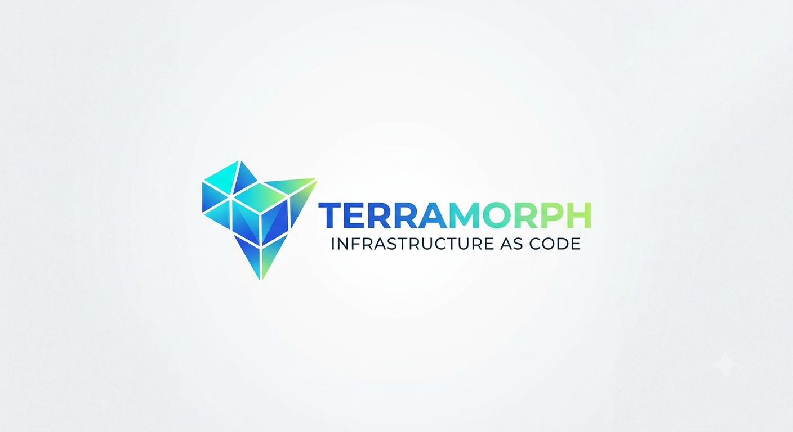

<p align="center">
  
</p>

<p align="center">
  <strong>Reverse Terraform</strong> — Discover existing cloud infrastructure, generate Terraform HCL code, import resources into state, and fix drift automatically with AI.
</p>

<p align="center">
  
  
  
  
  
  
</p>

---

## Overview

Terramorph scans your Google Cloud Platform and AWS projects, automatically generates production-ready Terraform configuration files, imports resources into state, and detects/fixes configuration drift using AI. It bridges the gap between manually created infrastructure and Infrastructure as Code (IaC).

### Key Features

- **Multi-cloud Discovery** — Scan GCP (47+ resource types) and AWS (20+ resource types)
- **Terraform Generation** — Flat resources or official Google/AWS modules with Jinja2 templates
- **Auto Import** — Upload your .tf files and automatically import existing infrastructure into Terraform state using AI-generated import blocks
- **Drift Detection & Auto-Fix** — Real-time terminal showing terraform init, plan, import, and AI-powered drift correction
- **AI Code Cleaning** — Remove defaults and optimize generated code using OpenAI, Anthropic, Gemini, Ollama, and more
- **Bulk Export** — Precise discovery via gcloud Cloud Asset API
- **Real-time Terminal** — WebSocket-based live streaming of all Terraform operations with ANSI color support

### Supported Resources (GCP)

Compute Engine, VPC Networks & Subnets, Cloud Storage, Cloud SQL, GKE, Firewall Rules, Load Balancers, Cloud Run, Cloud Functions, Pub/Sub, IAM & Service Accounts, Cloud DNS, Memorystore, BigQuery, Secret Manager, Artifact Registry, Cloud KMS, Cloud NAT, VPN, Cloud Armor, Health Checks, Instance Templates, Instance Groups, Compute Disks/Snapshots/Images, Filestore, Spanner, Dataflow, Composer, Cloud Scheduler, Cloud Tasks, Logging Sinks, Monitoring Alerts, VPC Connectors, Vertex AI, Bigtable, and more.

### Supported Resources (AWS)

EC2, VPC & Subnets, S3, RDS, EKS, Lambda, IAM, ELB, CloudFront, Route53, SQS, SNS, DynamoDB, ECS, Secrets Manager, CloudWatch, API Gateway, Elastic IPs.

## Quick Start

### Prerequisites

- Docker & Docker Compose
- GCP credentials configured via Application Default Credentials:

```bash
gcloud auth application-default login
```

### Run with Docker Compose

```bash
# Copy environment file
cp .env.example .env

# Start production
make prod

# Or start development (with hot-reload)
make dev
```

Access the web UI at `http://localhost:3000`

### CLI Usage

```bash
# Build the CLI
make build-cli

# Discover resources in a project
./cli/target/release/terramorph discover --project my-gcp-project

# Generate Terraform code
./cli/target/release/terramorph generate --job-id <job-id> --output ./terraform/
```

## Architecture

```
┌──────────────────┐         ┌──────────────────────────────────────────────────┐
│   CLI (Rust)     │────────▶│            Backend API (FastAPI)                  │
└──────────────────┘  HTTP   │                                                  │
                             │  ┌────────────┐  ┌──────────┐  ┌─────────────┐  │
┌──────────────────┐         │  │ Discovery  │  │Generation│  │ Auto Import │  │
│ Frontend (Next)  │────────▶│  │  Engine    │  │  Engine  │  │   + Drift   │  │
└──────────────────┘ HTTP/WS │  └─────┬──────┘  └────┬─────┘  └──────┬──────┘  │
                             └────────┼───────────────┼───────────────┼──────────┘
                                      │               │               │
                                      ▼               ▼               ▼
                             ┌────────────────┐ ┌──────────┐  ┌─────────────┐
                             │  GCP/AWS APIs  │ │  Jinja2  │  │  AI (LLM)   │
                             │  (via ADC)     │ │Templates │  │  + Terraform│
                             └────────────────┘ └──────────┘  └─────────────┘
```

## Sections

### Discover
Scan GCP or AWS projects to identify all existing infrastructure resources.

### Generate
Generate Terraform HCL code from discovered resources, with options for flat files or module-based structure, AI cleaning, and import blocks.

### Auto Import
Upload your own Terraform files (backend.tf required), and the app will:
1. Run `terraform init` and `terraform plan`
2. Fix any HCL errors using AI
3. Auto-generate `import.tf` based on resource types and Terraform provider documentation
4. Execute `terraform apply` to import resources into state
5. Detect drift and ask the user: fix with AI, download plan, or ignore

### Drift Fix
Real-time terminal showing every Terraform operation with a full pipeline:
- `terraform init` → `terraform plan` → AI error fix → `terraform apply` (import) → `terraform plan` (drift) → AI drift fix
- Stop button to cancel at any time
- Phase indicators and iteration tracking
- MesloLGS Nerd Font terminal with ANSI color support

### Settings
Configure AI providers (OpenAI, Anthropic, Gemini, Ollama, etc.) and AWS credentials.

## Required GCP Permissions

Minimum IAM roles for the authenticated user/service account:

- `roles/compute.viewer` — VM and network discovery
- `roles/storage.admin` — Bucket metadata listing
- `roles/cloudsql.viewer` — Cloud SQL instance discovery
- `roles/container.clusterViewer` — GKE cluster discovery
- `roles/resourcemanager.projectViewer` — Project enumeration

For organization/folder-level discovery:
- `roles/browser` — Organization hierarchy enumeration
- `roles/resourcemanager.folderViewer` — Folder listing

For drift detection and auto-import:
- Read/write access to the GCS state bucket
- Sufficient permissions to read resource attributes

## Development

```bash
# Backend
cd backend && pip install -r requirements.txt
uvicorn app.main:app --reload

# Frontend
cd frontend && npm install && npm run dev

# CLI
cd cli && cargo build
```

## Security

- **Zero credential storage** — ADC credentials are volume-mounted read-only, never persisted
- **Read-only discovery** — Discovery never modifies your cloud resources
- **Path sanitization** — Server filesystem paths are never exposed via WebSocket
- **Credential redaction** — GCP tokens, AWS keys, and private keys are redacted from terminal output
- **Non-root containers** — All services run as unprivileged users
- **No secrets in images** — Only credential file paths are passed via environment
- **Bounded resources** — WebSocket queues, subscriber limits, and log buffers are all bounded to prevent DoS

## Roadmap

Upcoming features and improvements planned for future releases:

- **Terraform plugin cache** — Shared provider binary cache to speed up `terraform init` (currently ~30-60s → ~2-3s)
- **Infrastructure from form** — Create new infrastructure directly from a visual form in the web UI, generating Terraform code without needing pre-existing resources (forward Terraform)
- **Multi-tenant SaaS mode** — OAuth-based authentication, team workspaces, and hosted deployment option
- **Terraform state visualization** — Visual graph of resource dependencies
- **Cost estimation** — Estimate infrastructure costs before applying changes

## License

MIT
